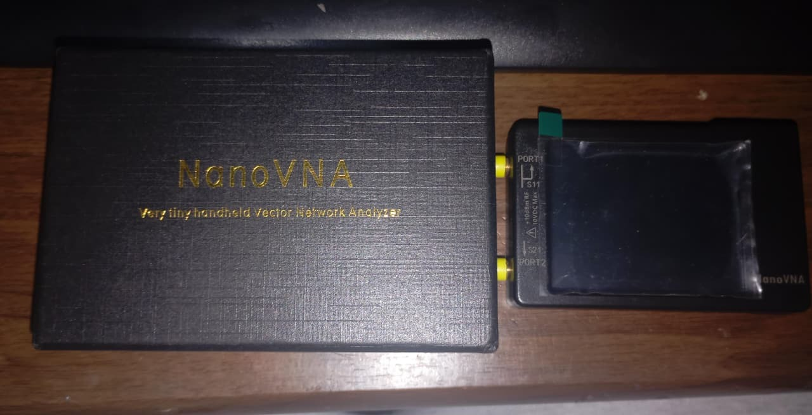
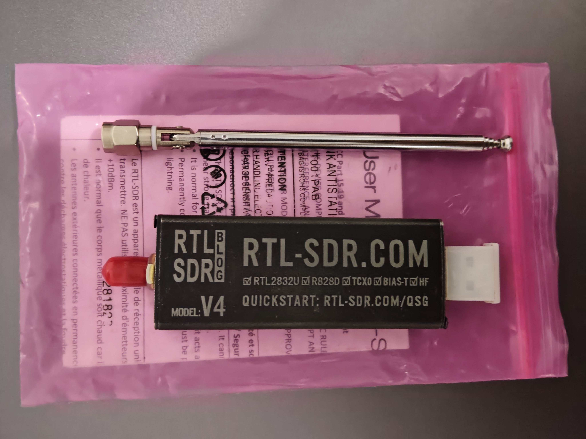
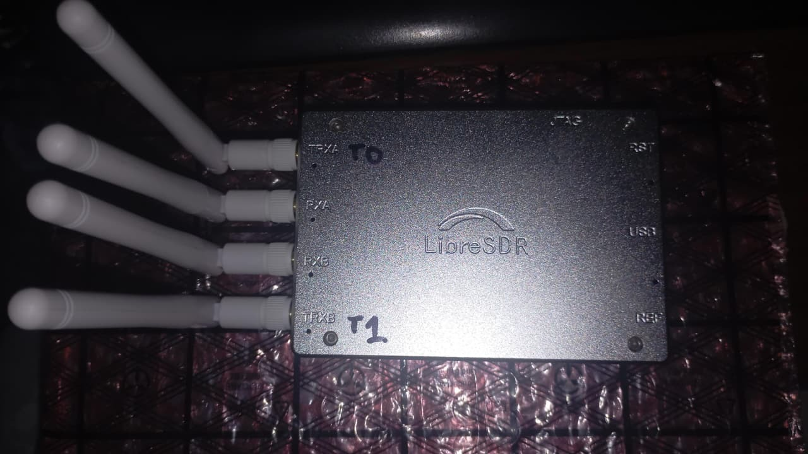
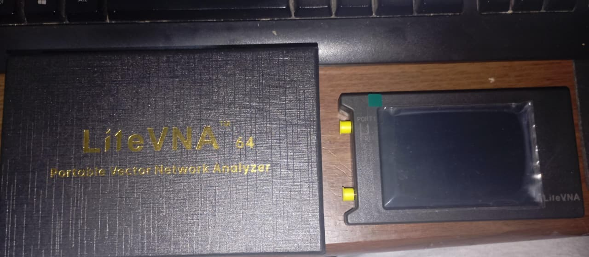
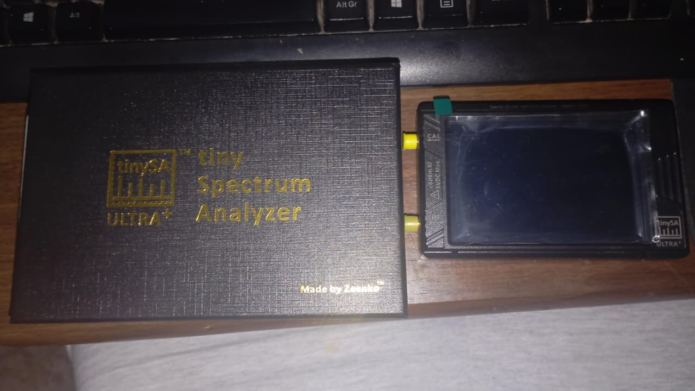
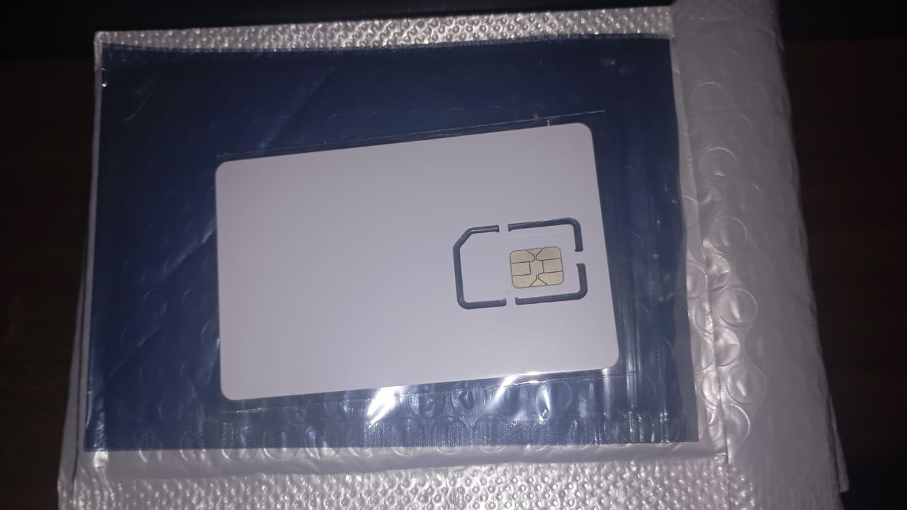
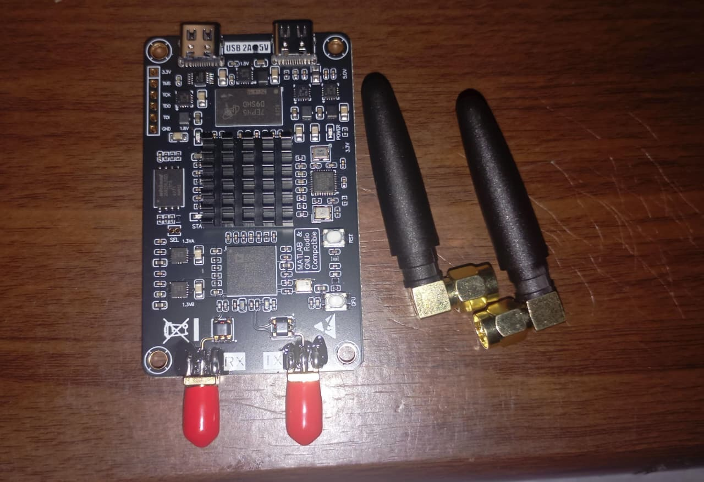
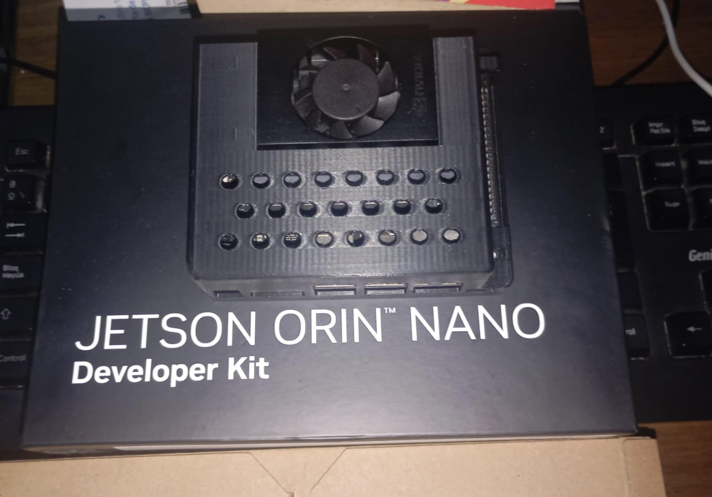
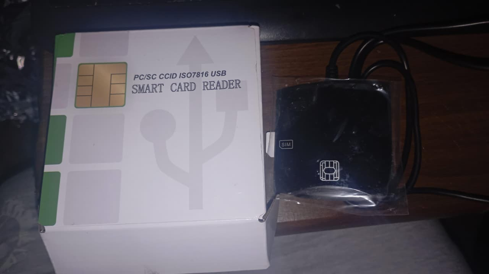

<h2>Mis equipos de trabajo</h2>

  Instrumentos que utilizo en mis proyectos,
  mediciones y pruebas experimentales.

<table>
  <tr>
    <td align="center" width="50%">
      
        
      <strong>01 · NanoVNA-H</strong>
       
      10 kHz – 1,5 GHz
        
    </td>
    <td align="center" width="50%">
      
        
      <strong>02 · RTL-SDR V4</strong>
        
    </td>
  </tr>

  <tr>
    <td align="center" width="50%">
      
        
      <strong>03 · B220 Mini AD9361</strong>
       
      70 MHz – 6 GHz · 2R2T
        
    </td>
    <td align="center" width="50%">
      
        
      <strong>04 · Zeenko LiteVNA 64</strong>
       
      Versión 0.3.3 · 50 kHz – 6,3 GHz
        
    </td>
  </tr>

  <tr>
    <td align="center" width="50%">
      
        
      <strong>05 · TinySA ULTRA PLUS</strong>
       
      Zeenko ZS-407 · 100 kHz – 7,3 GHz
        
    </td>
    <td align="center" width="50%">
      
        
      <strong>06 · LTE USIM</strong>
       
      4G · WCDMA · GSM
        
    </td>
  </tr>

  <tr>
    <td align="center" width="50%">
      
        
      <strong>07 · PlutoSDR Nano</strong>
       
      HamGeek · Zynq7010 + AD9363
        
    </td>
    <td align="center" width="50%">
      
        
      <strong>08 · Jetson Orin Nano</strong>
       
      Developer Kit
        
    </td>
  </tr>

  <tr>
    <td align="center" colspan="2">
      
        
      <strong>09 · Lector de tarjetas inteligentes SIM</strong>
        
    </td>
  </tr>
</table>

 

